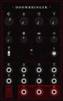

<p align="center">
  
</p>

<p align="center">
  
</p>

<p align="center">
  <a href="https://github.com/rossedman/doombringer/actions/workflows/ci.yml"></a>
  <a href="https://github.com/rossedman/doombringer/releases/latest"></a>
  <a href="LICENSE"></a>
  <a href="https://rossedman.io/doombringer/"></a>
</p>

# Doombringer

*A Portal Electronics module.*

**[Listen to it →](https://rossedman.io/doombringer/listen/)** Eight renders from the same DSP the module runs.

A four-pole ladder filter that summons what isn't there, for the Electrosmith patch.Init and VCV Rack. One portable DSP core runs on both, so a patch you find in one sounds the same in the other. It is the companion to [Death's Hand](https://github.com/rossedman/deaths-hand), the evil complex oscillator, and reads the same way: the cutoff and three character macros on the front, four settings on the patch.Init's shift layer, sigils instead of words.

Under the macros it is a careful ladder. The feedback loop is solved without a sample of delay, so it self-oscillates in tune from 33 Hz to 8 kHz (within 0.06 cents) and you can play it as an oscillator. A morph knob moves through five responses: four-pole low-pass, two-pole low-pass, band-pass, two-pole high-pass, four-pole high-pass. The extra parts:

- **WRATH** is the resonance and drive: clean, then ringing, then it screams on its own, then the input stage squares off what you feed it.
- **RUIN** corrupts the resonance: the feedback path folds, the output's own level bends the cutoff, and at the top the loop is pushed past the resonance knob until it breaks free of the input.
- **DOOM** summons undertones: it hears the input's pitch and mixes in squares an octave and two octaves below, which follow the input's envelope and die with it.
- **HUNGER** (shift layer) feeds the input's envelope to the cutoff, opening it on loud notes or, turned the other way, closing it.
- **PING** strikes the filter with a half-cycle at the cutoff, so it rings at the same level at any pitch: a drum with no input at all.

```
dsp/      portable engine — no heap, no platform headers, volts in / volts out
hw/       Electrosmith patch.Init() firmware (libDaisy)
vcv/      VCV Rack 2 plugin
test/     host tests and WAV renders
```

```
                             ┌──── RUIN: the output's level raises the cutoff ◄────┐
                             ▼                                                      │
in ─► + ─► 4× up ─► drive ─► (−) ─► clip ─► pole ─► pole ─► pole ─► pole ─┬─► taps ─► morph ─► 4× down ─► OUT
      ▲                       ▲                                           │                             └─► LP4
      │                       └──── resonance ◄── RUIN: the feedback folds ┘
      │
DOOM: the input's pitch divided by 2 and 4, enveloped, mixed back in as undertones
```

## Reading the panel

There are no words on the panel, only sigils. The top row is the voice: the cutoff and the three macros. Below them are the settings the patch.Init keeps on its shift layer. Each sigil repeats on the jack that modulates it, so the panel reads in columns. Sigils shared with [Death's Hand](https://github.com/rossedman/deaths-hand) mean the same thing on both.

| Sigil | Means |
|---|---|
| Eclipse (a crescent of shadow) | Cutoff · 1V/oct input |
| Flame | **WRATH** macro · its CV |
| Cracked ring | **RUIN** macro · its CV |
| Falling chevrons | **DOOM** macro · its CV |
| Serpent | Morph: LP4 → LP2 → BP → HP2 → HP4 |
| Spiral | FM depth · FM input |
| Maw | **HUNGER** · the envelope light · the envelope output (red) |
| Slit eye | Fine tune |
| Trident | Bass compensation. The red arrow is up = compensated |
| Lightning bolt | Ping: the button and its trigger input |
| Chalice | Audio input |
| Pillars and lightning | Restart the undertones |
| Blood drop (solid) | Filter out (the morph) |
| Blood drop with four poles | Four-pole low-pass out |

Bone rings mark inputs, red rings mark outputs, and the outputs sit on the altar. The Portal Electronics mark (the doorway with the eye, bottom left), the edge runes and the summoning circle are decoration.

## The macros

Each macro sweeps several parameters, each over its own stretch of the knob. ±5 V at a macro's jack sweeps its whole range.

| Macro | Sweeps | Along the knob |
|---|---|---|
| **WRATH** | resonance, drive | Clean to ringing through the lower 60%. The edge of self-oscillation is at 0.64; above it the filter screams on its own at 4.5 to 5 V. From halfway, a drive stage in front of the ladder squares the input off |
| **RUIN** | feedback fold, self-FM, loop overdrive | The lower half folds the resonance back on itself (metallic) without adding gain, so a ping still dies away. From 0.25 the output's level raises the cutoff: pings fall in pitch as they ring out, and a scream climbs. From 0.55 the loop's gain rises to 1.6× the resonance knob's, and the filter fights the input for the pitch |
| **DOOM** | undertones, lurch | The octave below arrives first, full by 0.35. The second octave below comes in from 0.35 to 0.7. From 0.7 the undertone swings the cutoff by up to 1.5 octaves, so the filter lurches on every other note |

**The input is RUIN's leash.** With RUIN in its upper half, a quiet input (around 1 V) lets the corrupted resonance break free: its pitch and the input's beat against each other and the spectrum goes inharmonic. A hot input (5 V) drags it back into step and the result stays harmonic. Ride the input level, or put a VCA in front, and you play the leash.

## Measured (host tests)

| | |
|---|---|
| Five responses against the analog shapes, at fc/4, fc and 4fc | within 0.01 dB |
| Self-oscillation, 1V/oct, −3 V … +5 V | worst error 0.06 cents |
| Self-oscillation level, every mode, resonance 1.01 … 1.1 | 3.8 … 5.8 V |
| Passband at resonance 0.95 | 0.0 dB compensated, −13.6 dB thin |
| Ping, 16 Hz … 8 kHz, resonance 0.8 … 0.99 | 4.3 … 4.9 V |
| Drive 0 / 0.5 / 1, 5 V sine | peak 5.00 V; third harmonic −75 / −12 / −10 dB |
| DOOM at full, 220 Hz saw | −1 octave +6 dB, −2 octaves +7 dB re the fundamental; silent 0.5 s after the input stops |
| HUNGER −1 / 0 / +1: fourth harmonic | −52 / −21 / −12 dB re the fundamental |
| RUIN 0.9 into a 1 V / 5 V saw: inharmonic share | 0.91 / 0.0002 |
| 60 s, every macro at full, 4 cutoffs, with and without input | finite, alive, DC under 0.17 V |
| patch.Init flash / RAM | 107 KB of 128 KB / 37 KB (arm-gcc 13.3) |

## Flash your patch.Init

### Fastest: prebuilt binary
1. Download `doombringer.bin` from the [latest release](https://github.com/rossedman/doombringer/releases/latest).
   Every asset is signed; see [Verifying releases](SECURITY.md#verifying-releases).
2. Put the Patch SM into its bootloader: hold **BOOT**, tap **RESET**, release BOOT
   (both buttons are on the Patch SM board on the back of the module).
3. Open Electrosmith's **Daisy Web Programmer** in Chrome (it uses WebUSB), connect
   the module over USB, choose `doombringer.bin` and flash.

### From source (macOS)
```sh
brew install --cask gcc-arm-embedded
brew install dfu-util
git submodule update --init --recursive     # pulls lib/libDaisy
make -C lib/libDaisy                        # once
make -C hw                                  # → hw/build/doombringer.bin
make -C hw program-dfu                      # after BOOT + RESET
```

`make -C hw CPU_METER=1` builds a variant that prints DSP load once a second over
USB serial (`screen /dev/tty.usbmodem* 115200`). That's the number to watch as
the engine grows.

## patch.Init control map

Four knobs, two layers: the front is the cutoff and the three [character macros](#the-macros); the shift layer holds the settings. **Hold the button** to reach the shift layer. A parameter only moves once its knob passes through the stored value (soft takeover), so switching layers never makes the sound jump.

| Knob | Front | Hold button (shift) |
|---|---|---|
| 1 (CV_1) + jack CV_5 | **Cutoff**, ten octaves, 16 Hz to 16.7 kHz. Jack is 1V/oct | **Morph**: LP4 → LP2 → BP → HP2 → HP4, continuous |
| 2 (CV_2) + jack CV_6 | **WRATH** | **FM depth** for audio IN R (noon = none; ±4 octaves per 5 V at the ends) |
| 3 (CV_3) + jack CV_7 | **RUIN** | **HUNGER** (noon = none; clockwise the envelope opens the filter, counter-clockwise it closes it) |
| 4 (CV_4) + jack CV_8 | **DOOM** | **Fine tune**, ±1 semitone (noon = in tune) |

Jacks always drive the front-panel parameter.

| Other | Does |
|---|---|
| Button tap | Ping |
| Toggle | Up = bass compensated (the passband holds its level as resonance rises), down = thin (it loses up to 14 dB, like the original ladder) |
| Audio IN L | Audio in |
| Audio IN R | Cutoff FM, audio rate, scaled by the FM depth |
| Gate 1 / Gate 2 | Ping / restart the undertones (both flip-flops high, so they line up with a beat) |
| Audio OUT L / R | Filter (the morph) / four-pole low-pass |
| CV OUT 1 | The input's envelope, 0 to 5 V (the one HUNGER and DOOM follow) |
| CV OUT 2 / LED | The envelope; full while shift is held |

### Things to verify on your unit (top of `hw/main.cpp`)
- `kAudioFullScaleV`: the volts a full-scale codec sample produces, in and out.
  It's set conservatively, so if the output is quiet, measure it and lower the number.
- `kInvertAudio`: the Patch SM's audio stages invert polarity. It doesn't matter
  for tones, but it does for a ramp filtered as CV.
- `kPitchCvScale` / `kPitchCvOffset`: 1V/oct trim for the cutoff. Send exactly 1 V
  and 3 V into CV_5 and use libDaisy's `VoctCalibration` to get the two numbers.
- Toggle direction: if "up" turns out to be thin, invert `ps.bassComp`.

## Five patches

Knob positions are clock faces: 7:00 is fully counter-clockwise, 12:00 is centre, 5:00 is fully clockwise. "S1"–"S4" means hold the button and turn knob 1–4. Untouched shift knobs stay at their defaults: LP4, no FM, no HUNGER, in tune. Each one is rendered by `make test` into `test/out/p*.wav`, and on the [listening page](https://rossedman.io/doombringer/listen/).

### 1 · Acid rite

A sixteen-step bassline that bites. Patch a sequenced saw through a VCA with a short, snappy envelope into IN L. Cutoff 10:50, WRATH 12:30, S3 (HUNGER) 3:30. Rock the cutoff slowly between 9:40 and 12:00, and halfway through bring **RUIN to 10:00**.

### 2 · Pitch-drop kicks

Nothing in the input: the filter is the drum. A clock into **Gate 1**. Cutoff 9:05, WRATH 1:00, RUIN 11:10. Each ping starts high and falls as it rings out. Turn WRATH up for longer tails, RUIN up for a deeper drop.

### 3 · The scream

Nothing in the input: the filter is the oscillator. A sequencer into **CV_5**. Cutoff 11:00, WRATH 2:30, S1 (morph) 9:30, for LP2. Sweep **RUIN from 8:30 to 1:30**: the tone grows harmonics, then climbs as its own level bends the cutoff.

### 4 · Undertow

A slow riff dragged down an octave and two. A saw sequence at A2 through a VCA with a slow envelope into IN L. Cutoff 12:00, WRATH 11:30, DOOM 3:30, S3 (HUNGER) 1:30.

### 5 · Devourer

A loud attack is swallowed and the tail blooms. Stab a minor chord of saws (A2, C3, E3) every two and a half seconds through a VCA with a long decay, into IN L. Cutoff 1:10, WRATH 12:30, RUIN 9:30, S1 (morph) 10:30, between LP2 and BP. Turn **S3 (HUNGER) almost fully counter-clockwise, to 7:50**: the louder the chord, the further the filter closes, so it opens as the chord dies away.

## Host tests
```sh
make test
```
Builds and runs `test/host_tests.cpp` and writes `test/out/*.wav` (the three
macro sweeps and the five patches). It checks the five responses against the
analog shapes, bass compensation, self-oscillation tracking and level, ping,
drive, the undertones, HUNGER, RUIN, stability under abusive settings, 60-second
runs with everything at full, and the macros, and exits non-zero on any failure.

## VCV Rack

The plugin mirrors the patch.Init: the cutoff and the three macros on top, the
shift-layer settings as their own knobs, a ping button, and the same jacks plus
the envelope. Knobs and CVs go through the same `doom::panelToParams` as the
firmware, so a patch translates one-to-one.

Each release has signed packages for Linux x64, Windows x64, macOS x64 and
macOS arm64. To build one yourself:

```sh
scripts/fetch-rack-sdk.sh ../Rack-SDK lin-x64   # or win-x64, mac-x64, mac-arm64
make -C vcv RACK_DIR=../../Rack-SDK install
```
The panel is generated: `make panel` writes `res/Doombringer.svg`,
`res/panel-preview.svg` (with stand-in knobs and jacks) and `src/PanelLayout.hpp` from one table, so the widget
positions can't drift from the artwork. Every sigil is drawn from code (no
fonts or images), so it renders in Rack and scales cleanly to a printed panel. It uses real Eurorack dimensions
(16 HP × 128.5 mm), so it's also a starting point for a physical panel.

## Design notes

The full notes are in [How it works](https://rossedman.io/doombringer/how-it-works/). In short:

- **A ladder in tune.** Four trapezoidal one-poles in a loop solved exactly each sample, with the cutoff prewarped by a Padé tangent, so resonance and self-oscillation land on the cutoff at every pitch.
- **A scream at one level.** The input stage is linear to half its clip level, and the clip is set from each mode's gain at the cutoff, so every mode self-oscillates at about 4.5 V.
- **RUIN without lock-up.** Only the AC part of the feedback folds, and the self-FM follows the output's magnitude, so nothing can latch the filter onto a DC level.
- **DOOM** is two flip-flops on the input's zero crossings, with envelope-scaled hysteresis and box-filtered edges, scaled by the input's envelope so silence stays silent.
- **CPU:** the cost is four 129-tap FIRs (the input and FM upsamplers, the two decimators). The FM upsampler idles while FM depth is at noon.

## Contributing

Bug reports, DSP fixes, tests and new ways to misbehave are welcome. Read [CONTRIBUTING.md](CONTRIBUTING.md) first; `make check` runs the lint, host tests and panel check that CI runs. This project follows the [Contributor Covenant](CODE_OF_CONDUCT.md). Report security problems privately, as described in [SECURITY.md](SECURITY.md).

## License

[MIT](LICENSE) © 2026 Ross Edman. The vendored fonts in `docs/assets/` are under the SIL Open Font License. The Portal Electronics logo (`docs/assets/portal.png`, and the mark traced from it in `vcv/res/make_panel.py`) is the maker's mark.
