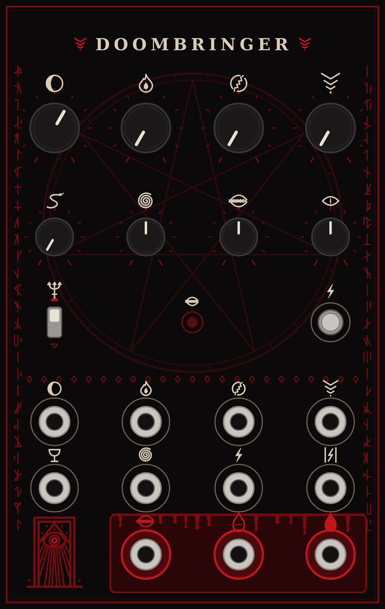

# Reading the panel

<figure class="diagram" markdown>
{ width="360" }
</figure>

There are no words on the panel, only sigils. The top row is the voice: the cutoff and the three macros. Below them are the settings the patch.Init keeps on its shift layer. Each sigil repeats on the jack that modulates it, so the panel reads in columns. Sigils shared with [Death's Hand](https://rossedman.io/deaths-hand/panel/) mean the same thing on both.

| Sigil | Means |
|---|---|
| Eclipse (a crescent of shadow) | Cutoff · 1V/oct input |
| Flame | **WRATH** macro · its CV |
| Cracked ring | **RUIN** macro · its CV |
| Falling chevrons | **DOOM** macro · its CV |
| Serpent | Morph: LP4 → LP2 → BP → HP2 → HP4 |
| Spiral | FM depth · FM input |
| Maw | **HUNGER** · the envelope light · the envelope output (red) |
| Slit eye | Fine tune |
| Trident | Bass compensation. The red arrow is up = compensated |
| Lightning bolt | Ping: the button and its trigger input |
| Chalice | Audio input |
| Pillars and lightning | Restart the undertones |
| Blood drop (solid) | Filter out (the morph) |
| Blood drop with four poles | Four-pole low-pass out |

Bone rings mark inputs, red rings mark outputs, and the outputs sit on the altar. The Portal mark (the doorway with the eye, bottom left), the edge runes and the summoning circle are decoration.

## The macros

Each macro sweeps several parameters, each over its own stretch of the knob. ±5 V at a macro's jack sweeps its whole range.

| Macro | Sweeps | Along the knob |
|---|---|---|
| **WRATH** | resonance, drive | Clean to ringing through the lower 60%. The edge of self-oscillation is at 0.64; above it the filter screams on its own at 4.5 to 5 V. From halfway, a drive stage in front of the ladder squares the input off |
| **RUIN** | feedback fold, self-FM, loop overdrive | The lower half folds the resonance back on itself (metallic) without adding gain, so a ping still dies away. From 0.25 the output's level raises the cutoff: pings fall in pitch as they ring out, and a scream climbs. From 0.55 the loop's gain rises to 1.6× the resonance knob's, and the filter fights the input for the pitch |
| **DOOM** | undertones, lurch | The octave below arrives first, full by 0.35. The second octave below comes in from 0.35 to 0.7. From 0.7 the undertone swings the cutoff by up to 1.5 octaves, so the filter lurches on every other note |

**The input is RUIN's leash.** With RUIN in its upper half, a quiet input (around 1 V) lets the corrupted resonance break free: its pitch and the input's beat against each other and the spectrum goes inharmonic. A hot input (5 V) drags it back into step and the result stays harmonic. Ride the input level, or put a VCA in front, and you play the leash.
